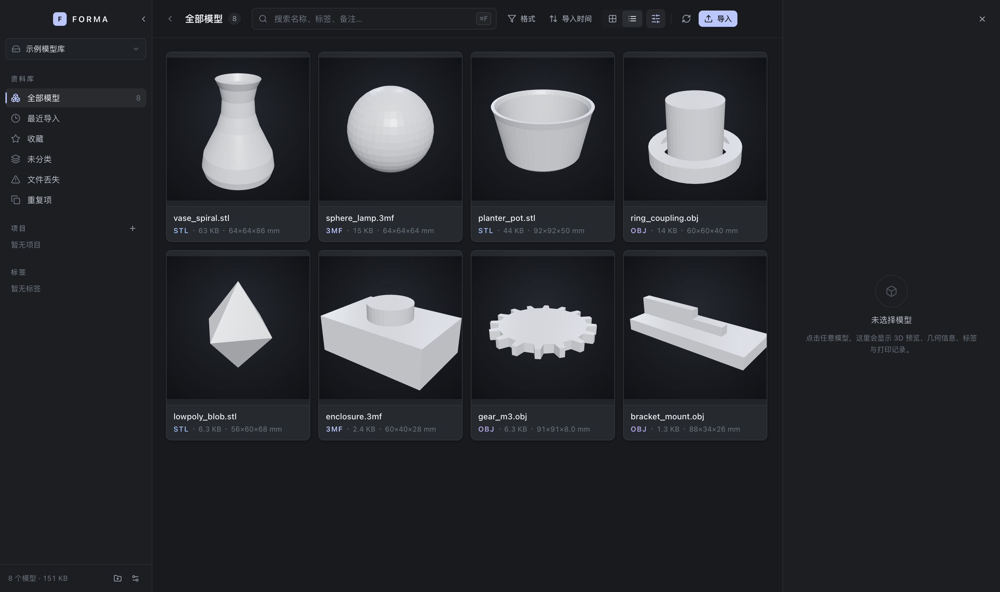
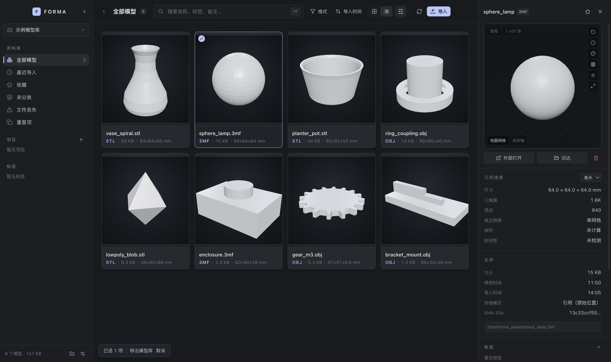
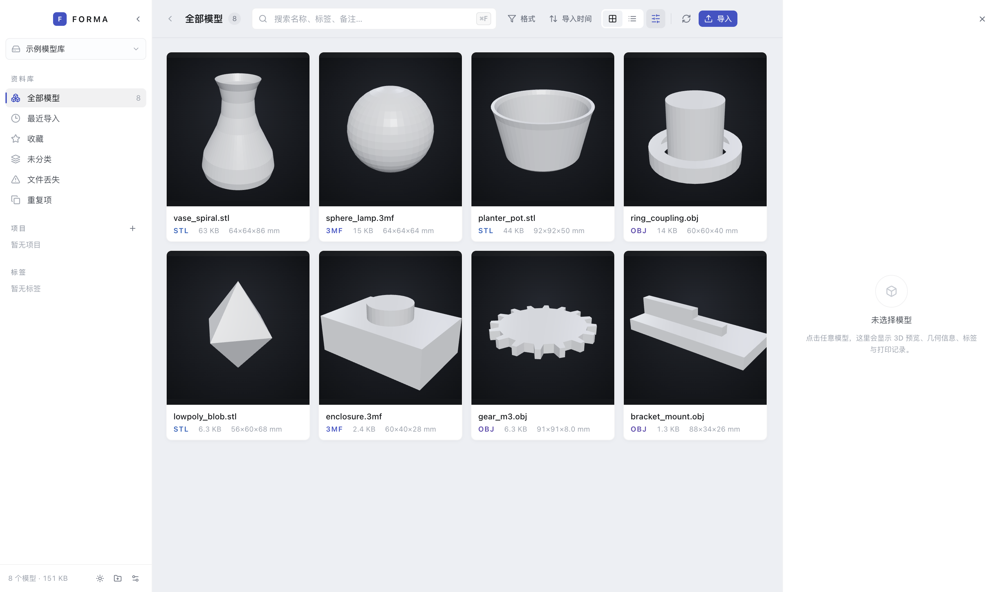

# FORMA

本地 3D 模型资产管理器 —— 像 Eagle 一样管理资产，像 Finder 一样操作文件，像专业 3D 查看器一样预览模型。

为 3D 打爱好者、数字雕塑、产品设计师准备。完全离线，模型与数据库都留在本机，不联网、不上传、不依赖云服务。



## 它能做什么

- **多个模型库**：任意本地文件夹都能作为库，支持引用模式（只建索引，不动原文件）与托管模式（复制进应用目录）
- **真实导入**：STL / OBJ / 3MF 解析，SHA-256 去重，读取包围盒、顶点数、三角面数、体积
- **真实缩略图**：每个模型离屏渲染生成，按内容哈希缓存，源文件一变就自动失效重渲
- **文件夹监控**：库目录里新增文件自动入库、删除自动标记「文件丢失」，不需要手动重扫
- **深色 / 浅色 / 跟随系统**：颜色全部走 CSS 变量，侧栏按钮或 ⌘⇧L 三态切换，设置持久化到 SQLite
- **标签 / 项目 / 收藏 / 打印记录**：全部落在 SQLite，重启不丢
- **一万条规模**：虚拟滚动 + 500 条一页的分页，滚动 120 次堆内存稳定在 25MB



浅色主题（同一套组件代码，只换颜色变量）：



应用图标（石墨丝网复古：等轴立方体 + 双线金环刻位 + 半调网点，配色与应用主体同源）：


## 技术栈

Electron · React · TypeScript（严格模式）· Vite · Tailwind CSS · SQLite（better-sqlite3）· Three.js / React Three Fiber · Zustand

三层职责分明：主进程管文件、数据库、解析、缩略图；preload 只暴露白名单 IPC；渲染进程不碰 Node API（`contextIsolation` 开启、`nodeIntegration` 关闭）。

## 快速开始

需要 Node 18+ 与 macOS / Windows。

```bash
npm install
npm run dev        # 开发模式
npm run build      # 构建三端产物
npm run typecheck  # TS 类型检查（node + web 两个 project）
npm test           # 解析器 / 几何 / 哈希 / 校验回归（23 条）
```

首次启动会引导新建模型库，也可以让它直接接管一个已有模型目录。

## 目录结构

```
src/
  main/       主进程：SQLite、解析器、导入、缩略图、文件夹监控、IPC
  preload/    contextBridge 白名单
  renderer/   React 界面：Sidebar / Toolbar / AssetGrid / Inspector / 3D 查看器
  shared/     主进程与界面共用的类型与通道定义
docs/         设计说明、监控说明、压测记录、实机截图
```

## 一些实现细节

**解析器**按格式注册成独立模块，导入时按扩展名分发；3MF 按 ZIP 容器解 `3D/3dmodel.model`，正确处理部件 transform 与单位声明，不支持的特性单独记进 `warnings` 而不是当作整体失败。

**缩略图**在主进程用离屏渲染生成，文件名为 `<modelId>.png`，索引记内容哈希；源文件替换后哈希变化会自动重渲，避免「同名文件更新后仍显示旧预览」。

**文件夹监控**两条通道并行：`fs.watch` 负责实时性，8 秒轮询快照负责可靠性（两者都按 `mtime` 判断变化），最终汇聚到同一个增量导入入口，所以去重、命名冲突、缩略图失效这些规则不会出现两套实现。

## 性能（一万条实测）

| 指标 | 结果 |
| --- | --- |
| 首页 500 条查询 | 1.05 ms |
| 深翻页 offset 9500 | 2.19 ms |
| 文件名模糊搜索 | 1.71 ms |
| 滚动 120 次后 JS 堆 | 25 MB（无增长） |
| 一万文件目录单轮扫描 | 82 ms |

详见 [docs/PERF-10000.md](docs/PERF-10000.md)。

## 已知限制

- 3MF 的材质、贴图、扩展组件只做提示，不做完整还原
- STL 不带单位信息，默认按 mm 显示但可在检查器里改，改完存库
- 文件夹监控发现文件消失只打标记，不会自动删记录 —— 物理删除永远由用户决定
- 打印记录是手工维护的台账，不控制打印机、不切片

## 文档

- [docs/GRAPHITE-STUDIO.md](docs/GRAPHITE-STUDIO.md) —— 界面设计令牌、尺寸、快捷键
- [docs/FOLDER-WATCH.md](docs/FOLDER-WATCH.md) —— 文件夹监控设计与验证记录
- [docs/PERF-10000.md](docs/PERF-10000.md) —— 一万条压测
- [docs/RUNNING.md](docs/RUNNING.md) —— 运行与打包
